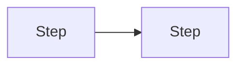
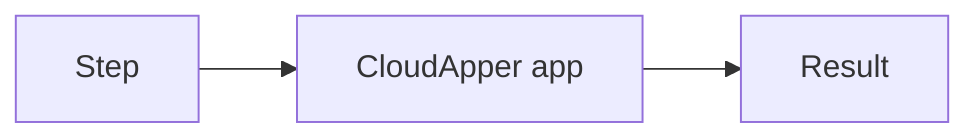

# {Project}: Business Requirements Document

| Field | Value |
|---|---|
| Document ID | {CUST}-{APP}-BRD-001 |
| Version / status | 0.1 Draft |
| Author | {Author, role} |
| Customer / project | {Customer / project} |
| Classification | Internal |
| Basis | {R1 session date, R2 …} |
| Standard | Structure based on ISO/IEC/IEEE 29148:2018 (BRS/StRS), tailored for CloudApper solutions |

**Revision history**

| Version | Date | Author | Change |
|---|---|---|---|
| 0.1 | {date} | {author} | First draft |

## 1. Executive summary

## 2. Business context

## 3. Business objectives

| ID | Objective | Measure (from → to) | By when |
|---|---|---|---|
| BO-1 | | | |

## 4. Stakeholders

| Stakeholder | Role | Interest / concern | Influence | Involvement |
|---|---|---|---|---|

## 5. Current process (as-is)

| Pain point | Impact | Frequency | Evidence |
|---|---|---|---|

## 6. Target process (to-be)

| User group | What changes | What stays manual |
|---|---|---|

## 7. Business rules

| ID | Rule | Example | Source | Owner |
|---|---|---|---|---|
| BR-1 | | | | |

## 8. Stakeholder requirements

| ID | Need | Stakeholder | Pri | Source · confidence | Objective |
|---|---|---|---|---|---|
| StR-1 | | | M | R1 · Stated | BO-1 |

## 9. Scope

| In scope | Out of scope (reason) | Future phase |
|---|---|---|

## 10. Data and systems

| Data item | Source of truth | Used by the app for | Volume |
|---|---|---|---|

## 11. Constraints, assumptions, dependencies

| ID | Statement |
|---|---|
| CON-1 | |
| AS-1 | |
| DEP-1 | |

## 12. Success criteria and benefits

| Objective | How measured | Who | When |
|---|---|---|---|

## 13. Risks

| ID | Risk | Likelihood | Impact | Mitigation | Owner |
|---|---|---|---|---|---|

## 14. Open issues

| ID | Question | Why it matters / what for | Owner | Due |
|---|---|---|---|---|

## 15. Glossary

| Term | Meaning |
|---|---|

## 16. Approval

| Role | Name | Decision | Date |
|---|---|---|---|
| Customer owner | | | |
| Project manager | | | |
