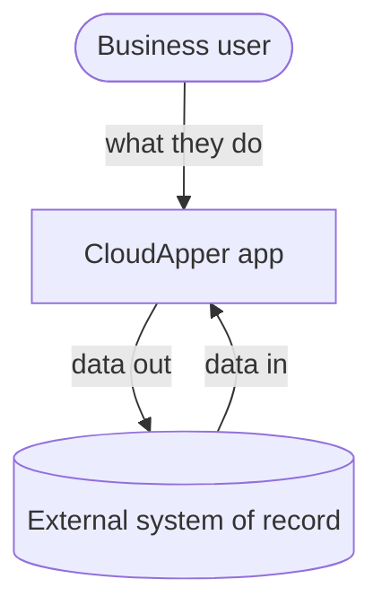

# {Project}: Software Requirements Specification

| Field | Value |
|---|---|
| Document ID | {CUST}-{APP}-SRS-001 |
| Version / status | 0.1 Draft |
| Author | {Author, role} |
| Customer / project | {Customer / project} |
| Classification | Internal |
| Basis | BRD {version}; {R1 session date, R2 …} |
| Standard | Structure based on ISO/IEC/IEEE 29148:2018; quality requirements by ISO/IEC 25010:2023; tailored for CloudApper solutions |

**Revision history**

| Version | Date | Author | Change |
|---|---|---|---|
| 0.1 | {date} | {author} | First draft |

## 1. Introduction

### 1.1 Purpose
### 1.2 Scope
### 1.3 Definitions and acronyms

**Priority (MoSCoW):** **M** must · **S** should · **C** could · **W** won't (this release).
**Source confidence:** *Stated* by the customer · *Proposed* by the team and not rejected · *Inferred* (to confirm).

### 1.4 References

| Ref | Document / session |
|---|---|
| R1 | |

## 2. Overall description

### 2.1 Product perspective

### 2.2 Business context
Objectives BO-… and to-be process: see BRD {version}.

### 2.3 User classes

| User class | Tasks | Frequency | Device | Role |
|---|---|---|---|---|

### 2.4 Operating environment

| Item | UAT | Production |
|---|---|---|
| CloudApper app | | |
| External system tenant | | |
| Time zone(s) | | |

### 2.5 Constraints, assumptions, dependencies

| ID | Statement |
|---|---|
| CON-1 | |

## 3. Functional requirements

### 3.1 {Feature area}
{One sentence of purpose.}

| ID | Requirement | Pri | Source | Acceptance criteria |
|---|---|---|---|---|
| FR-01 | The system shall … | M | R1 · Stated | Given … when … then … |

## 4. Non-functional requirements (ISO/IEC 25010:2023)

| ID | Characteristic | Requirement | Target / measure | Pri |
|---|---|---|---|---|
| NFR-01 | Performance efficiency | | | |
| NFR-02 | Reliability | | | |
| NFR-03 | Security | | | |
| NFR-04 | Maintainability | | | |

## 5. Interface requirements

| ID | System | Direction | Data | Trigger / frequency | Volume | Auth method | Error handling | Owner |
|---|---|---|---|---|---|---|---|---|
| IF-01 | | | | | | | | |

## 6. Data requirements

| ID | Record type | Key attributes | Unique key | Source of truth | Retention | Personal data |
|---|---|---|---|---|---|---|
| DR-01 | | | | | | |

## 7. Reports and outputs

| Report | Audience | Content | Filters | Format | Schedule |
|---|---|---|---|---|---|

## 8. Verification approach
{UAT test cases per acceptance criterion; measurements for NFRs; entry and exit criteria in the UAT plan.}

## 9. Out of scope

| Item | Reason |
|---|---|

## 10. Open issues

| ID | Question | Why it matters / what for | Owner | Due |
|---|---|---|---|---|

## 11. Traceability matrix

| BO / StR | BR | FR / NFR | IF / DR | TC |
|---|---|---|---|---|

## 12. Approval

| Role | Name | Decision | Date |
|---|---|---|---|
| Customer owner | | | |
| Project manager | | | |
| Solution engineer (feasibility) | | | |
