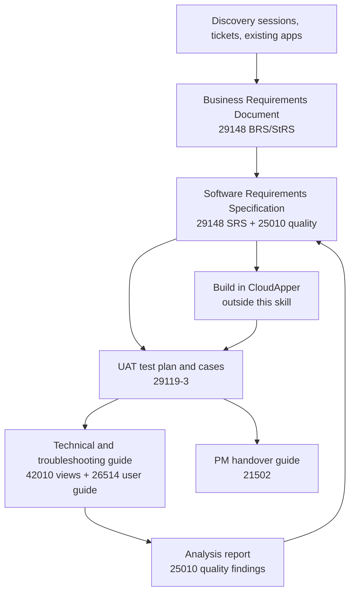

# Standards map: which standard each document follows

CloudApper solutions are small-to-medium no-code business apps delivered by a solution team to a customer, usually integrated with an HR or workforce system (often UKG). Full, heavyweight standards would cost more than they return, so each document follows **the structure and quality rules of one standard, tailored**: the sections that matter for a no-code business app are kept, the rest are left out on purpose and listed below.

## Contents
1. Chosen standards
2. Document set and life cycle
3. Tailoring decisions
4. Standards considered and not used
5. How to cite a standard in a document

## 1. Chosen standards

| Standard | What it gives | Used for |
|---|---|---|
| **ISO/IEC/IEEE 29148:2018** Requirements engineering | Business (BRS), stakeholder (StRS) and software (SRS) requirement documents; characteristics of a good requirement; traceability | Business Requirements Document, SRS, requirement quality checks |
| **ISO/IEC 25010:2023** Product quality model | Nine quality characteristics: functional suitability, performance efficiency, compatibility, interaction capability, reliability, security, maintainability, flexibility, safety | Non-functional requirements in the SRS; quality findings in analysis reports |
| **ISO/IEC/IEEE 42010:2022** Architecture description | Stakeholders, concerns, viewpoints and views | Architecture section of the technical guide (context, data, process, integration, environment views) |
| **ISO/IEC/IEEE 26514:2022** Information for users | Task-oriented user information, audience analysis, warnings, navigation | User guide section; PM guide plain-language parts |
| **ISO/IEC/IEEE 29119-3:2021** Test documentation | Test plan, test cases, test completion report | UAT test plan and test cases derived from SRS acceptance criteria |
| **ISO/IEC/IEEE 15289:2019** Content of life-cycle information items | Document identification, status, version, approval, revision history | Document control block on every deliverable |
| **ISO 21502:2020** Project management guidance | Business case, stakeholders, scope, risks, issues, benefits, handover | PM handover guide, risk and issue registers |
| **ISO/IEC/IEEE 12207:2017** Software life cycle processes | Names the processes: stakeholder needs, requirements, architecture, verification, validation, transition, maintenance | Umbrella that places each document in the life cycle |

## 2. Document set and life cycle

| Life cycle process (12207) | Document | Main reader | Reference |
|---|---|---|---|
| Business or mission analysis; stakeholder needs and requirements definition | Business Requirements Document (BRD) | PM, customer owner, team | `business-requirements.md` |
| System and software requirements definition | SRS (functional, non-functional, interface, data requirements) | Solution engineers, testers, PM | `srs.md` |
| Verification and validation | UAT test plan and test cases, test completion summary | Testers, customer key users, PM | `uat-test-documentation.md` |
| Transition, operation, maintenance | Technical and troubleshooting guide (as built) | Support, solution engineers | `technical-guide.md` |
| Project assessment and control; transition | PM handover guide | Project and account managers | `pm-handover-guide.md` |
| Quality assurance; maintenance | Analysis report | Team leads, managers | `analysis-checklist.md` |

Every document carries the document control block (`document-control.md`) and uses the same IDs, so one requirement can be followed from the business need to the test that proves it and the workflow that delivers it.

## 3. Tailoring decisions

| Standard | Kept | Left out, and why |
|---|---|---|
| 29148 | BRS and StRS merged into one BRD (the same people own both on a CloudApper project); SRS sections for functions, quality, interfaces, data, constraints, verification; requirement characteristics; traceability | Separate System Requirements Specification (SyRS): the platform is fixed, there is no hardware or system design to specify. Concept of operations as its own document: covered by the BRD's to-be process |
| 25010 | All nine characteristics as a checklist; only the relevant ones become requirements | Quality-in-use model and measurement formulas (ISO 25023): too heavy; each requirement states its own measurable target instead |
| 42010 | Stakeholders and concerns table; five views that answer CloudApper questions (context, data, process/workflow, integration, environment) | Formal architecture description language, correspondence rules and viewpoint library |
| 26514 | Task-based procedures, screen-by-screen guide, warnings, audience statement | Separate information-management plan and style guide (the skill's style rules play that role) |
| 29119-3 | Test plan (scope, approach, environment, entry and exit criteria), test cases with traceability, completion summary | Test design specification and incident reports as separate documents: defects live in the ticket system |
| 15289 | Identification, version, status, author, approvals, revision history, references, glossary | Full information-item catalogue |
| 21502 | Business case summary, stakeholders, scope, risk and issue registers, benefits, handover | Governance structures and portfolio management (organisation-level) |

## 4. Standards considered and not used

| Standard | Why not |
|---|---|
| IEEE 830-1998 | Withdrawn; replaced by ISO/IEC/IEEE 29148 |
| IEEE 829 / IEEE 1012 | Test documentation and V&V superseded for this purpose by 29119-3 |
| ISO/IEC/IEEE 15288 | System life cycle; 12207 already covers software solutions |
| ISO 9001 | Organisation-level quality management system, not document content |
| ISO/IEC 27001 | Information security management system; security requirements are covered through 25010 *security* and the analysis checklist. Reference it only when a customer requires it |
| arc42 / C4 model | Not ISO; useful practice. The technical guide's views follow 42010 and may use C4-style context and container diagrams |

## 5. How to cite a standard in a document

One line in the document control block: *"Structure based on ISO/IEC/IEEE 29148:2018, tailored for CloudApper solutions."* Do not claim conformance or certification: the documents follow the structure and quality rules, not an audited process.
