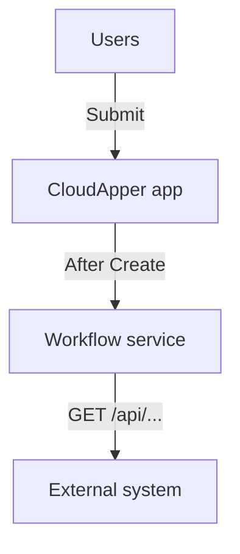
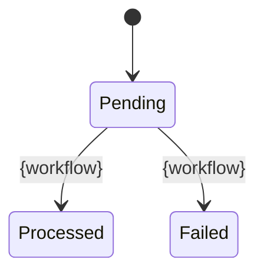
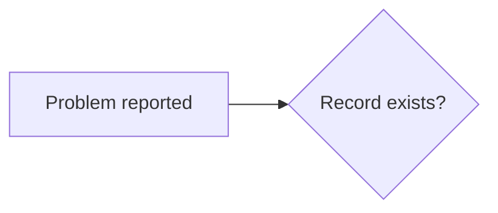

# {App Name}: Technical and Troubleshooting Guide

| | |
|---|---|
| Platform | CloudApper, tenant {tenant} |
| Environment read | {Production / UAT}, read-only walkthrough |
| Integrations | {UKG Pro WFM, SFTP, …} |
| Author | {Author} |
| Date | {YYYY-MM-DD} |

Personal data in screenshots is blurred.

## 1. What the application is for

{Business problem in two or three sentences.}

The application:
1. {automates …}
2. {…}

Users: {who}. Read section 2 to understand the app, section 3 if something is broken now.

## 2. How the application works

### 2.1 Flow in {N} steps

| Step | What happens | Started by | Workflow | Status after |
|---|---|---|---|---|
| 1 | | | | |

### 2.2 End-to-end flow

### 2.3 Status lifecycle

| Status | Meaning | If a record is stuck here |
|---|---|---|

## 3. Troubleshooting quick start

### 3.1 First five minutes
1. Find the record ({menu} → search by {key}).
2. Read **Status** and **{error field}**.
3. Open the **Audit Log** tab.
4. Check {related tabs}.
5. Compare with {external system}.
6. Decide: data issue or app issue.

### 3.2 Triage

### 3.3 Symptoms and fixes

| Symptom | Likely cause | What to do |
|---|---|---|

### 3.4 Known behaviours that look like bugs

| Behaviour | Why | Finding |
|---|---|---|

### 3.5 What to send when escalating
Record IDs, status, error text, Audit Log screenshot, external-system state, time with time zone.

## 4. Architecture

{Components diagram, layer table}

| Purpose | Method | Endpoint | Used by |
|---|---|---|---|

| Form | Menu | Records ({date}) | Purpose |
|---|---|---|---|

## 5. User guide

| Step | Status before | Button | What happens |
|---|---|---|---|

## 6. Internal processing in detail

### 6.1 {Stage}
Trigger: … Steps: 1. … Hard-coded values: … External calls: … Status writes: …

| Scheduled workflow | Schedule (UTC / local) | What it pulls | Volume |
|---|---|---|---|

## 7. Core workflow reference

| Workflow | Role | Trigger | Position |
|---|---|---|---|

### 7.1 Before anyone changes anything
{Order in the list, status triggers, Before vs After, UAT first, copy before editing.}

### 7.2 {Workflow name}

| Order | Node name | Type | What it does |
|---|---|---|---|

Things to know: …

## 8. Findings and recommendations

| # | Severity | Finding | Evidence | Recommendation |
|---|---|---|---|---|
| F-01 | | | | |

Priorities: now …, next …, later ….

## 9. Appendix

### 9.1 Workflow inventory
| Workflow | Trigger | Role | Active |
|---|---|---|---|

### 9.2 Open questions
| # | Question | Why we ask | Needed for |
|---|---|---|---|
