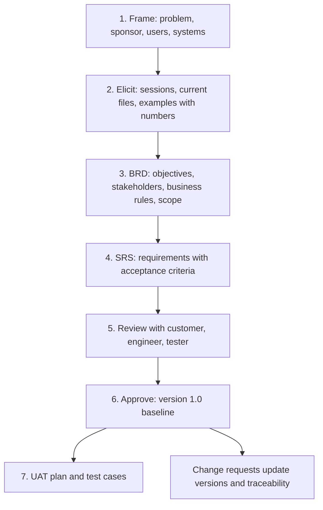
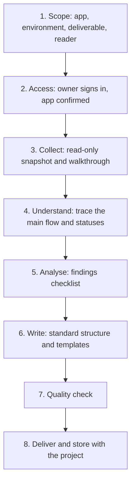

# CloudApper Solution Documentation: Method and Standards

| | |
|---|---|
| Audience | Managers, team leads, project and account managers |
| Author | Pablo Huanca |
| Date | 2026-11-09 |
| Version | 1.1 |

## In one sentence

Every CloudApper solution should have a short, current set of documents, from the business need to the as-built system: agreed requirements before the build, tests that prove them, and guides that let a new person understand the solution in one page, troubleshoot it within minutes and see its risks. This guide explains those documents, the international standards they follow, how they are produced without touching the live app, and what quality to expect.

## 1. Why documentation matters

| Without documentation | With documentation |
|---|---|
| Knowledge sits with the engineer who built the app | Anyone on the team can explain and support it |
| Incidents start with hours of discovery | Troubleshooting starts from a checklist and a triage diagram |
| Platform behaviours get escalated as bugs | Known behaviours are listed and explained |
| Risks (credentials, environment mix-ups, duplicate data) stay hidden | Risks are listed with severity, evidence and a recommendation |
| Handovers between PMs lose context | A PM guide carries the customer, the value, the people and the open items |

## 2. The deliverables

| Document | When | For | Answers | Typical length |
|---|---|---|---|---|
| **Business Requirements Document (BRD)** | Before design | PM, customer owner, team | Why the solution exists, objectives, stakeholders, business rules, scope | 8–15 pages |
| **Software Requirements Specification (SRS)** | Before build | Solution engineers, testers, PM | What the solution shall do and how well: functional, quality, interface and data requirements with acceptance criteria | 10–30 pages |
| **UAT test plan and test cases** | Before go-live | Testers, customer key users, PM | How each requirement is proven, and whether the solution is ready | 5–20 pages |
| **Technical and troubleshooting guide** | After go-live (as built) | Support analysts, solution engineers | How it works, what to do when it breaks, what each core workflow does | 15–40 pages |
| **PM handover guide** | At handover | Project and account managers | Customer, value, how it works in plain words, people, risks, communication | 10–20 pages |
| **Solution summary** | Any time | Managers, new team members | What is it for, how does it work on one page | 1–2 pages |
| **Analysis report** | Reviews, audits | Managers, team leads | What state the solution is in, what to fix first | 3–6 pages |

Requirement, test and finding IDs are shared across documents, so one business need can be followed to the requirement, the test that proves it and the part of the solution that delivers it.

## 2a. Standards behind the documents

Each document follows the structure and quality rules of an international standard, tailored for no-code business solutions. The documents follow these structures; they do not claim certification.

| Document | Standard | What it brings |
|---|---|---|
| BRD and SRS | ISO/IEC/IEEE 29148:2018 Requirements engineering | Standard sections, characteristics of a good requirement (necessary, unambiguous, verifiable…), traceability |
| SRS quality requirements, analysis findings | ISO/IEC 25010:2023 Product quality model | A checklist of nine quality characteristics (performance, reliability, security, maintainability…) |
| UAT documents | ISO/IEC/IEEE 29119-3:2021 Test documentation | Test plan, test cases, completion summary with go/no-go |
| Technical guide | ISO/IEC/IEEE 42010:2022 Architecture description; 26514:2022 Information for users | Views per reader (context, data, process, integration, environment); task-based user guide |
| PM handover guide | ISO 21502:2020 Project management | Business case, stakeholders, scope, risks, issues, handover |
| All documents | ISO/IEC/IEEE 15289:2019 Life-cycle information items | Document ID, version, status, approvals, revision history |

What was tailored out, and why: a separate system requirements document (the platform is fixed), formal architecture languages, and organisation-level governance. Requirements and UAT documents are approved by the customer owner and the PM; an approved requirement changes only through a change request.

All documents are internal. They are written in Markdown, so they can be read anywhere, versioned and moved to Confluence; a PDF is produced when someone asks for one.

### What a technical guide contains

1. **What the application is for:** the business problem and who uses it.
2. **How it works on one page:** a "flow in N steps" table, an end-to-end diagram, and the life of a record through its statuses.
3. **Troubleshooting quick start:** first five minutes checklist, triage diagram, symptoms and fixes, behaviours that look like bugs but are not, what to send when escalating.
4. **Architecture:** components, external systems and endpoints, data model.
5. **User guide:** screens and the step-by-step work procedure.
6. **Internal processing:** what happens behind each step, scheduled syncs.
7. **Core workflow reference:** step-by-step description of the workflows that carry the business logic.
8. **Findings and recommendations:** numbered risks with severity, evidence and recommendation.
9. **Appendix:** workflow inventory and open questions.

Sections 2 and 3 are written to work on their own: a reader who opens nothing else can still understand the app and start an investigation.

## 3. How requirements are produced (new solutions)

A good requirement is written as "The system shall …", states one observable behaviour with its condition and limit, has a priority (must, should, could, won't), names its source, and comes with acceptance criteria that a tester can pass or fail.

## 3a. How an existing solution is documented

| Step | What happens | Output |
|---|---|---|
| 1. Scope | Agree the app, the environment (Production or UAT), the document type and the reader. Existing documents and notes are read first. | Short scope note |
| 2. Access | The account owner signs in and opens the app. The app name is confirmed before anything is read. | Confirmed app |
| 3. Collect | The app's structure, workflows, record counts and recent run history are read; every screen is visited and captured. | Inventory, screenshots |
| 4. Understand | The main flow is traced from the user's action through each workflow and status, and checked against real records and their history. | Flow table, status lifecycle |
| 5. Analyse | The solution is reviewed against a checklist of risks seen in real production apps. | Findings F-01… |
| 6. Write | The document follows the standard structure; templates keep every app's guide consistent. | Draft |
| 7. Quality check | Screenshots, personal data, credentials, names, diagrams and open questions are checked against a fixed list. | Final document |
| 8. Deliver | The document is stored with the project and shared internally. | Published document |

## 4. Safety rules

Documentation work never changes a customer's solution.

| Rule | Why |
|---|---|
| **Read-only.** Nothing is created, edited, deleted, run or switched on or off. | Documentation must not cause incidents or change customer data. |
| **The account owner signs in.** Passwords are never typed or stored by the person documenting. | Credentials stay with their owner. |
| **The app is confirmed before reading.** | One account can hold several customers' apps. |
| **Credentials are reported, never copied.** A credential found in a workflow becomes a finding (where it is), not a value in a document. | Documents get shared; secrets must not. |
| **Personal data is blurred** in every screenshot. | Privacy of the customer's employees. |
| **Facts are verified and dated;** anything inferred is marked. | Readers must know what they can rely on. |
| **Anything that would need a test run becomes an open question** with why it matters. | Keeps the work read-only. |

## 5. Quality standards

A finished document:

- has an author, a date and the environment it describes;
- explains the app in one page and gives a troubleshooting starting point;
- uses the exact names of forms, workflows and buttons from the app;
- has diagrams that show only the running solution, its users and the external systems;
- lists every finding with severity, evidence (with date) and recommendation;
- shows no personal data, credentials or integration URLs that act as secrets;
- puts open questions inside the document, each with why it is asked and what the answer is needed for.

### Severity of findings

| Severity | Meaning | Examples |
|---|---|---|
| 🔴 High | Security exposure, data loss, wrong results reaching users or payroll | Credentials typed into workflows, test environment calling production systems |
| 🟠 Medium | Failures that need manual work, performance, environment differences | Sync without retry, duplicates from create-only syncs |
| 🟡 Low | Housekeeping, naming, documentation gaps | Test workflows left active, missing descriptions |

## 6. How to request a document

Send the team lead:

1. The customer and the app name, and which environment should be read.
2. The document type (section 2) and who will read it. For requirements: the session notes, current spreadsheets or forms, and who approves.
3. Who can sign in to the app for the walkthrough.
4. Any existing documents, tickets or notes.
5. The date it is needed.

## 7. How the method improves

The method is kept in a shared repository maintained by the Solution Delivery Engineering team. Every documentation or analysis project can add what it learned: a new risk for the checklist, a better explanation of a platform behaviour, a template improvement. Contributions are proposed as reviewed changes and approved by the owner before they become part of the standard, so every new document benefits from the previous ones.

| Who | Role |
|---|---|
| Owner (Pablo Huanca) | Approves changes to the method and templates |
| Solution engineers and analysts | Produce documents, propose improvements |
| Managers and PMs | Request documents, give feedback on what they need |

## 8. Open questions

| # | Question | Why we ask | Needed for |
|---|---|---|---|
| 1 | Where should finished documents be published (Confluence space, shared drive)? | One place makes them findable for support and PMs | Step 8 of the process |
| 2 | Which existing solutions should be documented first? | The method pays off most on apps with frequent incidents or upcoming handovers | Planning the first round |
| 3 | How often should documents be reviewed after app changes? | A guide that no longer matches the app misleads troubleshooting | Keeping documents current |
